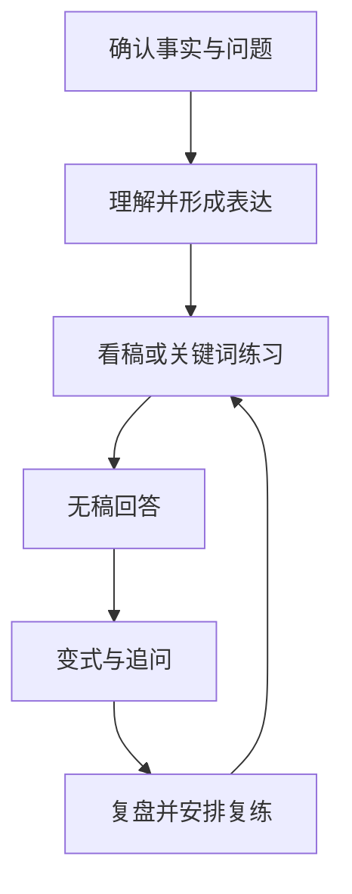

# Interview Pal 产品规格

版本：本地开发版 / 2026-10-10。本文描述产品目标、规则与范围；**当前仓库不是已经具备生产商用条件的在线服务**。可运行能力以实际代码和 `ACCEPTANCE.md` 中的验证结果为准，未验证项不得对外表述为已支持。

## 1. 产品定位

Interview Pal 帮助“懂技术、英文口语表达吃力”的中文算法工程师，把真实经历与技术知识练到能够独立说清楚，并应对追问。界面、操作说明与教练解释主要使用中文；面试问题、示例表达和口语练习使用英文。

初期集中在应用型 NLP 算法岗位，主题覆盖文本表示、检索、RAG、LLM 应用及必要的机器学习评估基础。首版不同时铺满 CV、AI 视频、语音、搜广推，也不承诺替代编程题、系统设计与全部求职准备。

首批假设人群为近期准备英文面试、有实际项目但容易卡词、偏题或依赖背稿的工程师。人群规模、学习时长、价格与转化率均尚待用户研究验证。

### 核心价值

1. 用已经确认的个人事实生成容易说出口的表达。
2. 把问题分成“技术不会”“懂但不会说”“没听懂问题”，采取不同训练方式。
3. 从看稿、关键词提示逐步走向无稿回答与新追问。
4. 让反馈定位到真实回答，知道下一次究竟改哪里。
5. 保留个人资料、答案与练习记录，形成可以继续的学习流程。

## 2. 产品目标与非目标

| 目标                     | 可观察证据                                       |
| ------------------------ | ------------------------------------------------ |
| 首次使用获得真实价值     | 完成一次回答、反馈、修改、复练，而非仅生成文案   |
| 从辅助表达迁移到独立应答 | 无稿回答和未提前展示答案的变式题表现             |
| 反馈可信                 | 指出实际回答中的证据；不确定时明确说明           |
| 经历真实                 | 生成稿不新增未经确认的履历、责任、指标或成果     |
| 可以持续使用             | 刷新后保留非音频资料；错误不丢输入；练习有下一步 |

非目标：实时面试代答、保证录用、消除中文口音、自动证明简历真实性、在没有音频分析时判断发音、用示例数据营造个人已完成的训练历史。

## 3. 当前交付与规划边界

本次技术形态为 React / Vite / TypeScript 响应式前端，加 Express 本地单用户 API 代理。

| 能力     | 本地开发版边界                               | 后续产品能力                     |
| -------- | -------------------------------------------- | -------------------------------- |
| 学习资料 | 浏览器 localStorage 保存非音频资料与练习记录 | 服务端持久化、多设备同步与备份   |
| 录音     | MediaRecorder 录制、本地 Blob 回放           | 可控保留期、云存储、断点上传     |
| 文本模型 | 配置服务端模型后调用真实 LLM；未配置明确提示 | 多供应商、预算治理与服务质量监控 |
| ASR      | 配置兼容转写服务后上传用户选择的音频         | 术语适配、音质诊断及可靠性评测   |
| 反馈     | 对用户提供或确认的文本做内容与表达建议       | 经人工校准的语音与技术联合评价   |
| 发音分   | 不以文本、计时或浏览器转写代替发音评测       | 专用评测服务与本场景验证         |
| 用户体系 | 本机单用户学习空间                           | 登录、鉴权、租户隔离与权限管理   |
| 商业能力 | 无真实支付、订阅或计费保证                   | 订单、额度账本、退款、计费幂等   |
| 面试通话 | 录音或文本的分轮训练                         | 可打断、可恢复的实时语音模拟     |

localStorage 不是安全数据库。它通常只属于当前浏览器与站点来源；浏览器清理、隐私模式退出或来源改变可能导致资料不可用。音频 Blob 不作为长期数据保存，刷新或关闭页面后可能失效。界面和导出说明必须讲清这一点。

### 代码内容快照

当前种子题库有24题，全部标记为`reviewed: false`。其中机器学习、NLP、检索与RAG各4题作为核心样例；搜广推4题、CV 2题、语音1题、视频1题作为扩展预览。它们是带来源的原创练习素材，尚不等于经过专家审核的正式题库，更不代表已经把八个方向做成熟。后续收费内容仍应按单领域优先的范围收敛，详见`CONTENT_GUIDE.md`。

初次打开包含明确标识的Alex示例资料，真实练习记录为空。用户建立个人计划时应清空示例并录入自己的事实。当前只有一个本地活动岗位计划；`resumeVersion`是导入计数，项目编辑使自我介绍标记待复核，完整事实依赖版本系统尚未实现。

## 4. 核心对象

| 对象       | 业务含义                         | 必须保留的关系                   |
| ---------- | -------------------------------- | -------------------------------- |
| 个人资料   | 简历原文、技术、教育、工作和项目 | 哪些内容来自用户；哪些仍待确认   |
| 目标岗位   | 方向、级别、JD、面试日期         | 决定选题和表达重点               |
| 个人事实   | 背景、职责、行动、结果、约束     | 原文来源与确认状态               |
| 自我介绍稿 | 用户可修改的英文口语稿           | 来源事实、修改内容、使用长度     |
| 题目       | 一个具体能力的提问入口           | 主题、难度、要点和追问           |
| 项目       | 一个可深入讨论的真实经历         | 个人贡献与团队成果分别记录       |
| 练习尝试   | 某次文本或录音作答               | 使用了什么提示、原回答、反馈来源 |
| 复盘记录   | 某次练习的可检查反馈             | 不能脱离原回答或虚构语音证据     |
| 能力状态   | 借助提示、独立完成、待复习       | 不直接等同于面试通过概率         |

代码类型是当前实现的字段事实来源。不能仅因本文提出一个对象，就假定已经完成完整的版本关系、迁移或服务器存储。

## 5. 共用训练闭环

闭环原则：

- 内容模块可自由进入；低分或未完成不锁死整条路线。
- 每次优先处理最多三个对理解最重要的问题。
- 看稿朗读、关键词复述和无稿回答是不同状态，不能混记为独立掌握。
- “没有听懂”“不知道技术答案”“知道但说不出”需要不同的下一步。
- 技术错误不能用流利表达抵消，流利度也不能从文本长度推断。
- 连续卡住时允许简化问题、换短句、看提示或跳过。
- 延迟复习、新问法和追问是成熟产品规则；当前代码未覆盖的部分作为明确的后续任务。

## 6. 模块规则

### 自我介绍

输入支持简历文本、用户草稿或少量履历要点。优先解释当前身份、与岗位相关的经历、真实贡献、求职方向。不同长度的稿件是可选择的目标，不要求每个人说满固定时间。

生成后必须可编辑。用户确认内容符合经历后再练习。不能自动增加名校、任职年限、主导职责、指标提升或业务规模。逐句练习是教学动作，整段独立表达是另一项验证。

### 专业题库

先选用户真实接触过、与岗位相关的题。没有简历时允许按主题进入。题目至少提供问题、训练目标或要点；题目及答案的审核状态须诚实标记，代码内种子内容不等同于完成了专家审核。

内容反馈接受合理替代表述，不能只比较参考答案相似度。对存在争议的答案允许保留意见并继续练习。没有实时检索或有效来源支持时，不应宣称已验证最新模型和产品规格。

### 项目工作室

先练一个最有代表性的真实项目。结构为背景与目标、个人职责、选择和行动、难点、评估与结果、复盘。缺失信息应问用户，不填入看似真实的数字。

追问应围绕当前事实或回答，例如“为什么选择这个方案”“怎样验证改进”。假设性改进必须保留“如果重新做”的语义，不能改写成已完成的工作。

### 反问与通用沟通

结合 JD 练习确认岗位范围、成功标准、技术挑战和团队协作。缺少目标公司可靠资料时，只生成可询问的问题，不生成该公司内部事实。训练澄清问题、争取思考时间、说明未知，不能把合理的澄清行为机械扣分。

### 复盘

有实际记录才显示个人报告。空状态引导完成首次练习。报告应注明输入是文本还是音频转写、反馈来自哪个能力、语音是否真正分析过。

## 7. 评分与事实可信度

当前未接入专用语音评测时：

- 可以评价回答相关性、结构、关键内容及英文措辞。
- 不能评价发音准确率、音素、重音、真实语速、停顿与口音。
- ASR 文本是识别结果，不是实际发音质量分。
- 浏览器语音播放用于示范，不代表专业录音或评测。
- 无模型配置时不能返回随机分、固定“80分”、假装分析成功的报告。

成熟版可以研究“80分”作为特定任务、特定引擎下经校准的练习目标。它不是英语等级、行业标准或录用概率。通过规则应同时考察事实、技术、可理解度和独立性。

## 8. 首次价值与产品研究

建议以12—20位近期准备英文面试的目标用户开展探索性访谈和约两周人工辅助训练。数字是研究设计建议，不是已完成样本量或效果结论。

前后测使用同能力、近似难度的不同题目，盲评时打乱录音顺序。预先确定改善标准，同时报告参加人数、完成者和退出者；不能只展示表现好的用户。

核心指标：首次完整练习循环完成率、新问题上的表达改善、延迟复测覆盖率、已复测保持率、可靠反馈比例、真实付费意愿与单位服务成本。复测覆盖率和保持率必须分开，未复测结果标记未知。

## 9. 发布声明

对当前版本可使用“本地可继续开发的练习应用”“可以配置真实模型服务”。不可使用“生产商用已就绪”“已验证提升面试通过率”“支持专业发音诊断”“跨设备永久保存”等超出实现与测试证据的表述。

关联文档：`PAGE_DESIGN.md` 定义页面，`DESIGN_SYSTEM.md` 定义视觉和交互，`DEVELOPMENT.md` 解释代码与运行，`ACCEPTANCE.md` 记录验收，`ROADMAP.md` 管理后续范围。
